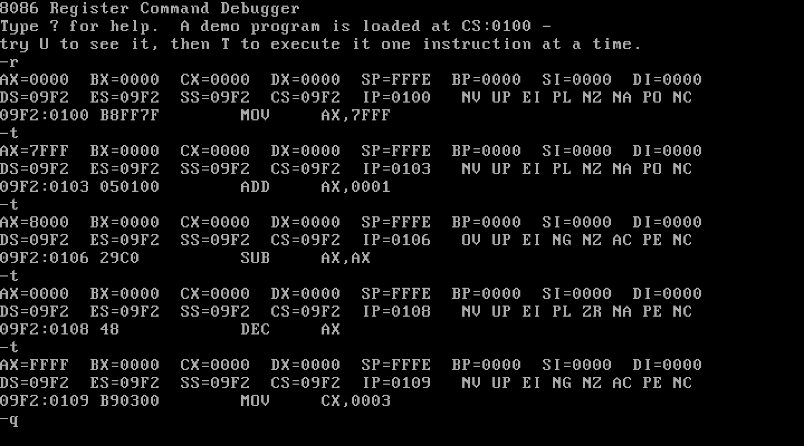
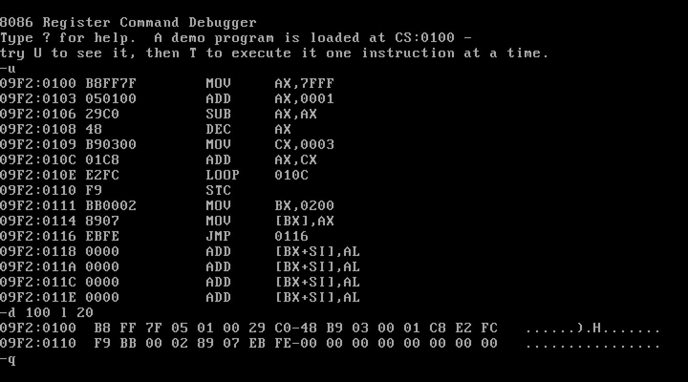
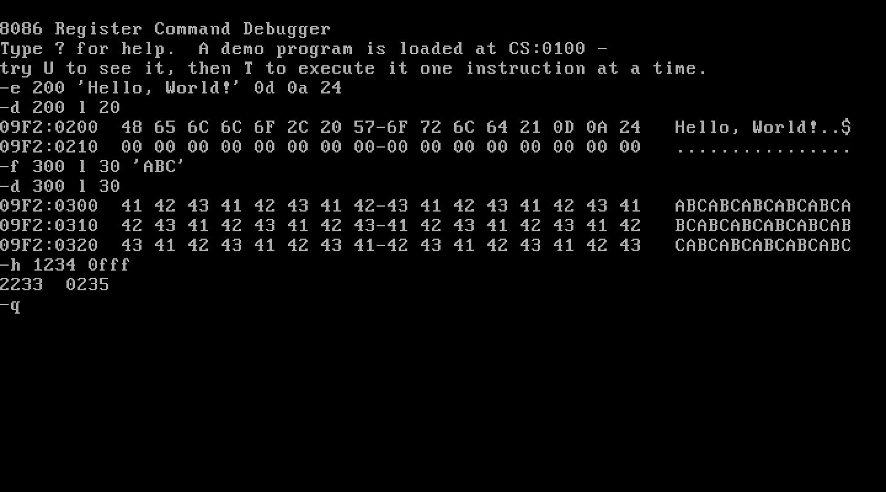
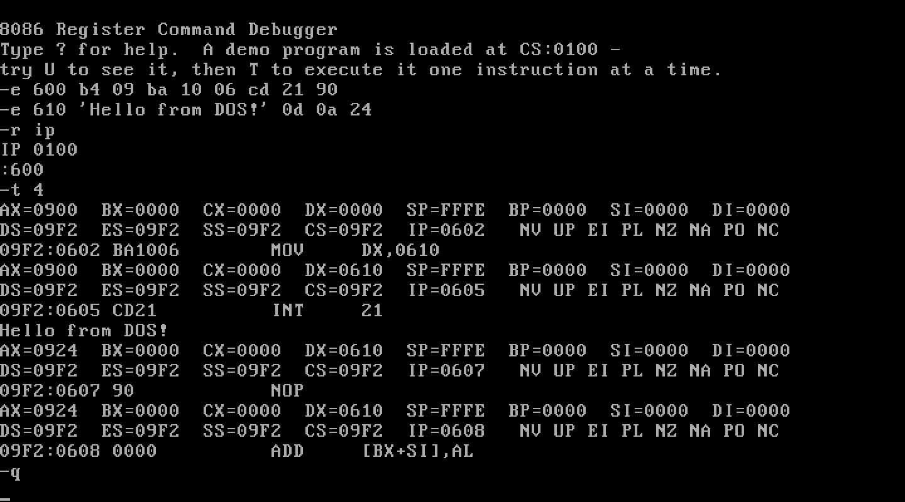
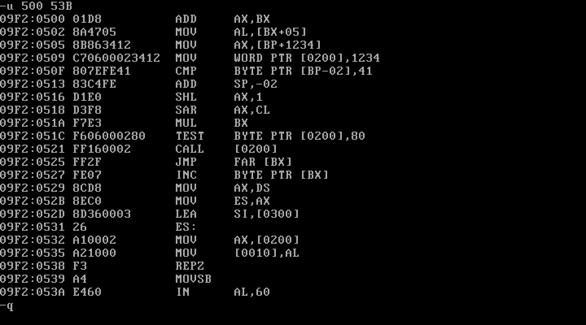

# 8086 Register Command Debugger

[](https://github.com/Usman-Azfar/8086-assembly-debugger/actions/workflows/build.yml)

A machine-level debugger for MS-DOS, written in pure 8086 assembly language and modelled on the classic `DEBUG.COM`. It loads a program into its own 64 KB memory segment. From there you can inspect and change its registers, flags and memory, disassemble its code, and **execute it one real CPU instruction at a time** using the processor's Trap Flag.

The whole program assembles to a **6 KB DOS executable** and uses no instructions newer than the original 8086. The `.8086` directive makes the assembler enforce this.

### ▶ [Try it live in your browser](https://usman-azfar.github.io/8086-assembly-debugger/)

No install needed. The demo runs the real `CPROJ.EXE` inside DOSBox compiled to WebAssembly ([js-dos](https://js-dos.com/)), rebuilt from the latest source on every push.



*Stepping through the built-in demo program in DOSBox-X. Each `t` runs one real instruction. After `ADD AX,0001` turns `7FFF` into `8000`, the CPU's overflow, sign, auxiliary-carry and parity flags are set (`OV NG AC PE`). After `SUB AX,AX` the zero flag is set (`ZR`).*

## Screenshots

All screenshots are of the real program running in DOSBox-X.

| | |
|---|---|
|  |  |
| **`U` and `D`:** the demo program disassembled, then dumped as hex and ASCII | **Memory:** entering a string with `E`, filling a pattern with `F`, dumping with `D`, hex arithmetic with `H` |
|  |  |
| **Tracing a DOS call:** a small program typed in with `E` calls `INT 21h` to print a string. `T` runs the whole interrupt as one step. | **Disassembler:** ModR/M addressing modes, `BYTE`/`WORD PTR`, far jumps, segment and `REP` prefixes |

## Try it: a 2-minute tour

Open the [live demo](https://usman-azfar.github.io/8086-assembly-debugger/), or run it yourself (see [Building and running](#building-and-running)). Click the DOS screen and type these commands, pressing Enter after each:

| Type | What you'll see |
|---|---|
| `r` | All registers, the flags (`NV UP EI PL NZ NA PO NC`) and the next instruction, `MOV AX,7FFF` |
| `u` | The built-in demo program, disassembled |
| `t` | One real instruction executes: `AX` becomes `7FFF` and `IP` moves to `0103` |
| `t` | `ADD AX,0001` executes: `AX=8000`, and the CPU sets overflow, sign, auxiliary-carry and parity (`OV NG AC PE`) |
| `t 10` | The rest of the demo runs; it stores `AX` at `DS:0200` |
| `d 200 l 10` | A memory dump showing the stored value, `05 00` |
| `e 300 'Hello' 0d 0a 24` | Writes a string into memory; `d 300 l 10` shows it |
| `r f`, then `cy zr` | Sets the carry and zero flags; `r` shows `ZR` and `CY` |
| `x` | An unknown command: a `^ Error` caret points at it |
| `?` | The list of every command |

## Commands

Letters can be upper or lower case, and all numbers are hexadecimal.

| Command | What it does |
|---|---|
| `R` | Show all registers, the flags and the next instruction |
| `R reg` | Change a register (`AX BX CX DX SP BP SI DI DS ES SS CS IP`) |
| `R F` | Change flags by name, e.g. `CY ZR` to set carry and zero, `NC NZ` to clear them |
| `D [addr] [range]` | Dump memory as hex and ASCII |
| `E addr list` | Enter bytes and strings into memory: `E 200 48 69 "!" 24` |
| `F addr range list` | Fill memory with a repeating pattern: `F 300 L 40 "AB"` |
| `U [addr] [range]` | Unassemble (disassemble) 8086 code |
| `T [count]` | Trace: execute instructions one at a time, showing the registers after each |
| `H val1 val2` | Hex calculator: prints the sum and the difference |
| `?` | Help |
| `Q` | Quit |

An address is `offset`, `segment:offset`, or a segment register and an offset (`CS:100`). A range is an end offset or `L length`. Errors are reported the way `DEBUG.COM` reports them, with a `^` under the character that caused the problem.

## How it works

### Real single-stepping (`T`)

The debugger does not simulate the CPU. It runs the instruction on the real processor and catches control again afterwards:

```text
   debugger                                      program being debugged
   ────────                                      ──────────────────────
   save own SS:SP
   switch to the program's stack
   push  FLAGS (TF=1), CS, IP
   load  AX..DI, DS, ES from the register file
   IRET  ─────────────────────────────────────►  one instruction runs
                                                 CPU sees TF=1, raises INT 1
   trap_handler  ◄───────────────────────────────┘
   save every register back to the register file
   restore own SS:SP and return to the command loop
```

Interrupt instructions need special handling. The CPU clears the Trap Flag when it enters an interrupt handler, and the trap then only fires after the instruction *following* the handler's `IRET`, so a naive step over `INT 21h` would run two instructions. For `INT n` and `INTO` the debugger instead plants a temporary `INT 3` breakpoint (`CCh`) on the next instruction and runs without the Trap Flag. A test case covers this. `T` also refuses to execute `INT 20h`, `INT 27h` and the terminating `INT 21h` functions, because DOS would end the debugger itself rather than the program being debugged.

### Disassembler

`U`, and the third line of `R` and `T`, use a disassembler that decodes the complete 8086 instruction set. That includes every ModR/M addressing mode, the group opcodes (`80h–83h`, `D0h–D3h`, `F6h/F7h`, `FEh/FFh`), far pointers, segment and `REP` prefixes, and signed displacements, in `DEBUG.COM`'s output format. Opcodes that do not exist on the 8086 are shown as `DB xx`.

### Design notes

- **Table-driven.** Register names and values sit in two parallel tables, so displaying and editing all 13 registers takes one loop. Flags are a table of `(bit mask, "set" text, "clear" text)`, and the disassembler's mnemonics are fixed-width name tables indexed by opcode fields.
- **One output path.** Every character goes through `put_char`, which can capture output into a buffer instead of the screen. The disassembler uses the normal print routines to build an instruction's text before it knows how many bytes to print in front of it.
- **Isolated memory.** The program's memory is a real 64 KB block allocated from DOS (`INT 21h/48h`), cleared, with `INT 20h` at offset 0 as in a real PSP. The demo program at `0100h` is chosen to make each flag change.
- **Robustness.** Ctrl-C is intercepted (`INT 23h`) so that it does not end the debugger while its interrupt vectors are hooked. The original vectors are restored on `Q`.

## Project layout

```text
src/
  CPROJ.ASM     start-up, memory allocation, command loop, help
  CONSOLE.INC   console I/O, DOS line input, output capture, error caret
  PARSE.INC     parsing of numbers, addresses, ranges and byte lists
  REGS.INC      register file, flag table, R command
  MEMORY.INC    D, E, F and H commands
  DISASM.INC    8086 disassembler, U command
  TRACE.INC     T command: Trap Flag stepping, breakpoints, INT 1/INT 3 handler
tests/
  run_tests.py  builds the program and runs every test session in DOSBox-X
  cases/        scripted sessions (.in) and the output they must produce (.exp)
web/
  index.html    the live-demo page (js-dos)
  dosbox.conf   DOSBox settings for the demo
  make_site.py  packs CPROJ.EXE into a js-dos bundle for GitHub Pages
docs/
  screenshots/  the images in this README
build.bat       one-line build with JWasm
```

## Building and running

You need a MASM-compatible assembler and a DOS environment.

1. Get the code:
   ```text
   git clone https://github.com/Usman-Azfar/8086-assembly-debugger.git
   ```
2. Install [JWasm](https://github.com/Baron-von-Riedesel/JWasm) (free, MASM-compatible) and [DOSBox-X](https://dosbox-x.com/) or DOSBox.
3. Build: run `build.bat`, or `jwasm -mz -Fo CPROJ.EXE CPROJ.ASM` inside `src/`. JWasm writes a DOS `.EXE` directly, so no linker is needed.
4. Run it in DOSBox:
   ```text
   mount c path\to\8086-assembly-debugger\src
   c:
   CPROJ
   ```

You don't have to build it yourself: every successful CI run publishes `CPROJ.EXE` as a downloadable artifact (you need to be signed in to GitHub) on the [Actions page](https://github.com/Usman-Azfar/8086-assembly-debugger/actions/workflows/build.yml).

The build is tested with JWasm 2.20. The source sticks to standard MASM syntax, but other assemblers (MASM, TASM) have not been tested.

## Tests

`tests/run_tests.py` assembles the program, feeds each scripted session in `tests/cases/` to it inside DOSBox-X through DOS input redirection, and checks the output line by line.

```text
python tests/run_tests.py --jwasm path\to\JWasm.exe --dosbox path\to\dosbox-x.exe
```

The expected results were worked out by hand from the 8086 rules, not copied from the program's own output. For example, `trace` checks every register and every flag after each of the demo program's 15 instructions, and `disasm` checks 40 instructions across the decoder's main paths. GitHub Actions runs the whole suite on every push and publishes `CPROJ.EXE` as a build artifact.

| Test | Covers |
|---|---|
| `regs` | Register display and editing, case-insensitivity |
| `flags` | Setting, clearing and rejecting flags with `R F` |
| `trace` | Every step of the demo program, with exact flag results |
| `int` | Stepping over `INT 21h` and `INT 3`, blocking program-terminating calls |
| `memory` | `D` alignment and ranges, `E` with strings, `F` patterns, `H` |
| `disasm` | 40 instructions across the decoder's main paths |
| `errors` | Error caret position for each kind of syntax error |

## Limitations

- Only `T` (trace) runs code. There is no `G` (go) or `P` (proceed) command, no assembler (`A`) and no loading of programs from disk (`N`/`L`) yet.
- An instruction that clears the Trap Flag itself (for example `POPF` with TF=0 on the stack) lets the program run freely, as it does in `DEBUG.COM`.
- Values for `DS`, `CS` and so on depend on where DOS loads the program, so they will differ from the screenshots.

## History

This project started as a simpler program that imitated the `R` command of `DEBUG.COM`, using copies of the registers stored in variables. It has since been rewritten into a working debugger: registers, flags and memory are now real, and `T` executes real instructions. The original version is preserved in the git history.

## License

MIT. See [LICENSE](LICENSE).
